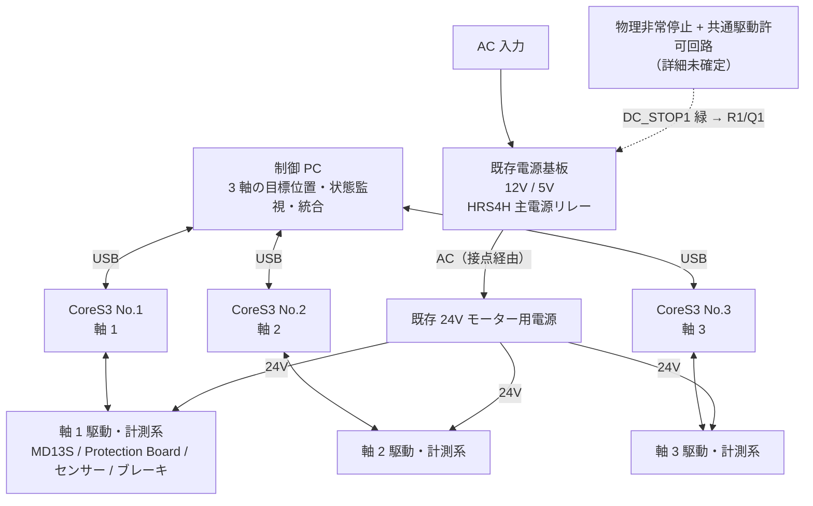
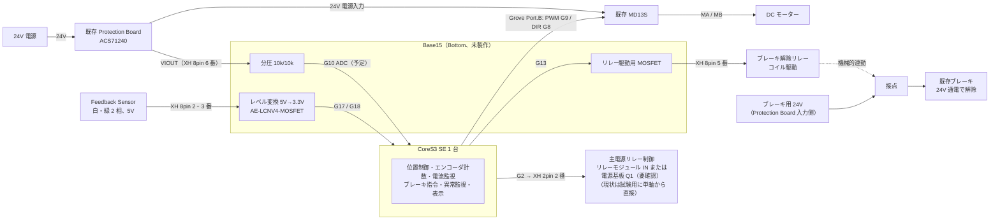

# M5Stack CoreS3 による 3 系統独立制御系の設計

故障したオリジナル制御基板（STM32F401 による 3 軸集中制御）を、**モーター 1 系統につき 1 台の M5Stack CoreS3** で置き換える。
電力系（電源基板、24V 電源、Protection Board、MD13S、モーター、ブレーキ）はそのまま流用し、制御基板が担っていた機能だけを 3 台の CoreS3 と最小限のインターフェース回路に移す。

## ページ一覧

| ページ | 内容 |
| --- | --- |
| [hardware.md](hardware.md) | CoreS3 と Base15、M-Bus / XH ソケットの GPIO 割当、MD13S・リレー・レベルシフタ・分圧回路の配線、部品リスト |
| [software.md](software.md) | ファームウェア設計。タスク構成、PCNT 計数、PWM 出力、状態機械、USB プロトコル、PC 側の統合、現状の実装（`moter-controler` / `encoder-tester`） |
| [safety.md](safety.md) | 安全設計。主電源インターロック、非常停止、ブレーキ操作順序、通信断・異常時の停止、GND と電源分離 |
| [progress-and-open-issues.md](progress-and-open-issues.md) | 進捗、試験結果、未確定事項、次の作業 |

## 設計方針

1. **3 軸独立**。CoreS3 を 3 台使い、1 台で 1 モーターの位置制御・エンコーダ計数・電流監視・ブレーキ指令・異常監視・表示を完結させる。
2. **PC が統合**。PC は Pitch / Roll / Yaw から各軸の目標位置を計算し、USB ×3 で各 CoreS3 に送る。制御ループを PC 経由にしない。PC 側の通信方式は元の H3 を踏襲しない（自作ソフトで置き換える）。
3. **配線を最小化**。専用 PCB は作らない。CoreS3 の Bottom を Base15 産業用プロト基板モジュールにし、そのプロト領域にリレー駆動用 MOSFET と既製のレベルシフタを実装して、外部とは XH 8pin / XH 2pin と Grove Port.B（MD13S）のロック付きコネクタで接続する。イベント当日の接触不良リスクを減らす。
4. **コスト度外視で確実性と安全性を優先**。各台に画面があるため、ステータス表示と故障切り分けが容易。同じファームウェアを 3 台に入れ、軸 ID だけ切り替える。
5. **安全はソフトだけに頼らない**。主電源リレーは 3 軸共通のインターロックと物理非常停止で扱い、各軸は通信断・センサー異常・追従異常を検出したら自律的に停止する。ESP32-S3 の 2 コアに処理を分けても、電源・メモリ・クロックを共有するため独立した安全系にはならない。

## 全体アーキテクチャ

CoreS3 への給電は Base15 の DC ジャック（9〜24V → 5V）または USB を想定し、モーター用 24V とは分離する。既存 5V と CoreS3 の 5V を並列接続しない。Base15 にバッテリーは無く、DC 入力と USB を同時に接続したときの挙動は未検証。

## 1 軸の詳細（3 軸同一）

## 流用・置換・追加の境界

| 区分 | 対象 |
| --- | --- |
| 流用 | 既存電源基板、別体 24V 電源、Protection Board ×3、MD13S ×3、モーター、Feedback Sensor、ブレーキ |
| 置換対象 | オリジナル制御基板（STM32、U5/U6 ADS1015、K1〜K4 ブレーキリレー、表示、USB） |
| 追加 | CoreS3 SE + Base15 ×3（Base15 内にエンコーダ用レベルシフタ、VIOUT 用分圧、ブレーキ用リレー駆動 MOSFET を実装）、XH 8pin / 2pin ケーブル、ブレーキ用リレー ×3、Grove 変換ケーブル（MD13S） |
| 設計を詰める部分 | 共通非常停止・主電源インターロック、ブレーキの作動順序、各回路の給電と逆流防止、GPIO の最終割当、原点復帰と可動範囲 |

## オリジナル構成との対比

| 機能 | オリジナル | 新設計 |
| --- | --- | --- |
| 制御 MCU | STM32F401CCU6 ×1 で 3（4）軸 | ESP32-S3（CoreS3）×3 で各 1 軸 |
| エンコーダ計数 | TIM1〜4 エンコーダモード | ESP32-S3 PCNT、4 逓倍 |
| エンコーダ入力 | 5V 信号を STM32 に直結 | AE-LCNV4-MOSFET で 3.3V に変換 |
| 電流監視 | VIOUT ×4 → ADS1015 → I²C | VIOUT → 分圧 → 内蔵 ADC（軸ごと） |
| ブレーキ | 1 本の GPIO で K1〜K4 一括。各軸 24V を NO 接点で開閉 | 軸ごとに独立したリレー。G13 → Base15 内 MOSFET → リレー（新設計） |
| 主電源リレー | PB10 → DC_STOP1 緑 | 共通インターロック経由で DC_STOP1 緑を駆動（現状は試験用に G2 から） |
| PC 通信 | USB CDC、DOF Reality 独自プロトコル | USB CDC ×3、自作プロトコル |
| 表示 | OLED（SCREEN1） | 各 CoreS3 の 320×240 画面 |
