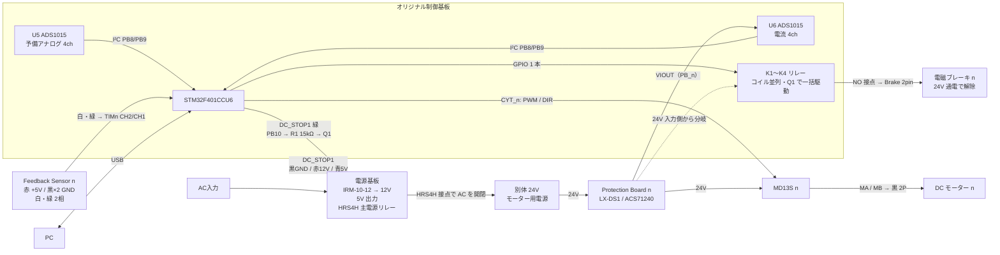

# DOF Reality H3 既存構成の調査結果

オリジナルの H3 コントローラーユニットを、電源基板・制御基板・モータードライバ・保護基板・モーター・ブレーキに分けて調べた結果のまとめ。
調査の動機は「リレーが動かず、PC から COM ポートも認識されない」という故障。原因分析は途中で保留し、制御基板を CoreS3 で置き換える方針に切り替えた（[故障診断の経緯](troubleshooting-log.md)）。

## ページ一覧

| ページ | 内容 |
| --- | --- |
| [power-board.md](power-board.md) | 電源基板。IRM-10-12（12V）、5V 出力、HRS4H 主電源リレー、DC_STOP1 コネクタ、R1/Q1 駆動回路、別体 24V モーター電源 |
| [control-board.md](control-board.md) | オリジナル制御基板。STM32F401CCU6 ボード、コネクタ（PB_n / CYT_n / 8pin / DC_STOP1）、K1〜K4 リレー、U5/U6 = ADS1015、エンコーダ入力ピン、GND 構成 |
| [motor-driver.md](motor-driver.md) | Cytron MD13S と Protection Board LX-DS1（ACS71240 電流センサ） |
| [motor-and-feedback-sensor.md](motor-and-feedback-sensor.md) | H3 公開仕様、モーター 3 系統、8pin コネクタ、2 相エンコーダの配線と電圧 |
| [brake.md](brake.md) | 電磁ブレーキの動作方式（24V 通電で解除）、原基板での駆動方法 |
| [troubleshooting-log.md](troubleshooting-log.md) | 故障診断の測定値と判断の経緯 |

## 全体ブロック図（実測ベース）

`n` は軸 1〜3。制御基板には 4 軸分（PB_4 / CYT_4 / K4 / TIM4）が実装されているが、H3 では 4 軸目は未使用。



## 1 軸あたりの外部接続

```text
24V電源 → Protection Board（ACS71240）→ MD13S 電源入力 → MA/MB → 黒2Pコネクタ → モーター

モーター付属ケーブル（8pin コネクタ）
  ├── Feedback Sensor 6pin（5線使用）
  │     ├── 赤        : +5V（電源基板の 5V）
  │     ├── 黒 ×2     : GND
  │     ├── 白・緑    : STM32 タイマー入力（2相エンコーダ）
  │     └── 残り 1pin : ケーブル側 NC（基板側は抵抗経由で U5 へ）
  └── Brake 2pin → 制御基板 K1〜K3 の NO 接点（24V は Protection Board 入力側から）
```

## 確定事項と未確定事項の要約

### 実測で確定

- 電源基板は 12V（IRM-10-12）と 5V を制御基板へ供給し、別体 24V モーター電源への AC 給電を HRS4H リレーで開閉する。
- 主電源リレーは STM32 の PB10 → DC_STOP1 緑線 → R1（15kΩ）→ Q1 で駆動される。3.3V ロジック。
- PB_1〜3 → Protection Board #1〜3、CYT_1〜3 → MD13S #1〜3。PB_4 / CYT_4 は NC。
- Protection Board は 24V 電源と MD13S 電源入力の間にあり、U1 は ACS71240（電流センサ）。4pin は GND / +24V / VIOUT / +5V。
- VIOUT 4 系統は U6（ADS1015）に集約され、I²C（PB8/PB9）で STM32 へ。
- Feedback Sensor は赤 +5V、黒×2 GND、白・緑が STM32 の TIM1〜4 CH2/CH1 に直結。停止時に緑 5V、白 約 0.1V。
- 8pin の Brake 2pin は K1〜K4 の接点につながる。K1〜K4 のコイルは並列で、制御基板上の Q1 により 1 本の GPIO で一括駆動。接点は NO。
- ブレーキは 24V 通電で解除、無通電で作動（24V をリレーで供給するとモーターがスムーズに回った）。
- Protection Board の信号 GND と、MD13S 向け電源 GND は導通する。制御系 GND とモーター電源 GND は共通。

### 推定（確度高）

- Feedback Sensor は 5V 系の 2 相インクリメンタルエンコーダ。元ファームウェアはタイマーのエンコーダモードで計数していた。
- U5 も ADS1015（刻印 BRPI が一致）。今回のモーターケーブルでは入力が NC のため未使用。
- VIOUT はブレーキ電流を含まず、MD13S への給電電流を測っている。

### 未確定

- エンコーダの分解能（PPR）、減速比、センサーが計測している軸、出力段（プッシュプル／オープンコレクタ）、最大パルス周波数。
- ブレーキの消費電流、解除・作動の遅延時間、保持能力、動的制動の可否。
- 主電源リレー駆動の Active High/Low、Q1 の型番。
- 制御基板上でブレーキリレー Q1 を駆動している STM32 のピン番号。
- ACS71240 の型番末尾（感度・ゼロ点）、FAULT 出力の使用有無。
- 5V 供給経路で 2.1V 降下していた原因（解析保留）。
